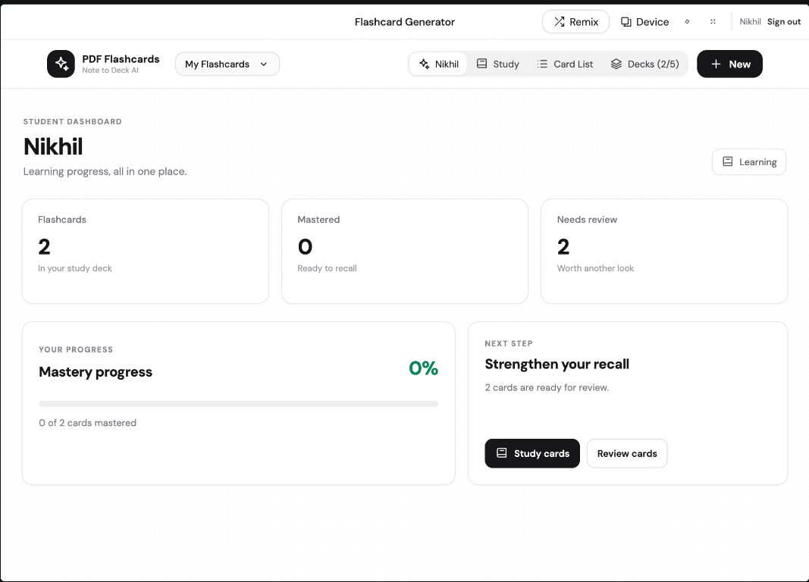

# Flashcard Generator

A full-stack flashcard study app for creating decks, reviewing cards, and tracking learning progress. The React interface communicates with an Express API backed by SQLite.



## Features

- Register, sign in, sign out, or continue in guest mode
- Create and switch between up to five study decks
- Add flashcards with a term and definition
- Flip cards, navigate with buttons or keyboard shortcuts, and shuffle a study session
- Mark cards as mastered and filter by cards that need review
- View dashboard statistics and overall mastery progress
- Import legacy cards saved in browser storage when entering guest mode
- Responsive layouts for desktop, tablet, and mobile

## Tech Stack

- React 18 and Vite
- Express
- SQLite through `better-sqlite3`
- Node.js 20+

## Getting Started

Install dependencies:

```bash
npm install
```

Start the API and Vite development server together:

```bash
npm run dev
```

The client is available at `http://127.0.0.1:5173`. It proxies `/api` requests to the API server at `http://127.0.0.1:3001`.

## Available Scripts

| Command | Description |
| --- | --- |
| `npm run dev` | Run the API and Vite client in development mode |
| `npm run dev:server` | Run only the Express API |
| `npm run dev:client` | Run only the Vite client |
| `npm run build` | Create a production build in `dist/` |
| `npm run preview` | Serve the existing `dist/` build with Express |
| `npm start` | Run the Express server |

For a production-style local run:

```bash
npm run build
npm start
```

The Express server serves the built client from `dist/` and listens on `http://127.0.0.1:3001`.

## Configuration

The server supports these environment variables:

| Variable | Default | Description |
| --- | --- | --- |
| `PORT` | `3001` | Port for the Express server |
| `DB_PATH` | `data/flashcards.sqlite` | Path to the SQLite database |
| `NODE_ENV` | unset | Set to `production` to enable secure session cookies |

Example:

```bash
PORT=8080 DB_PATH=./data/study.sqlite npm start
```

## Storage

SQLite data is stored at `data/flashcards.sqlite` by default. The database uses WAL mode and maintains users, sessions, decks, and cards.

The default database and generated build directory may contain local or generated files and should not be committed.

## Keyboard Shortcuts

| Key | Action |
| --- | --- |
| `Space` | Flip the current card |
| `Left Arrow` | Previous card |
| `Right Arrow` | Next card |
| `M` | Toggle mastered status |
